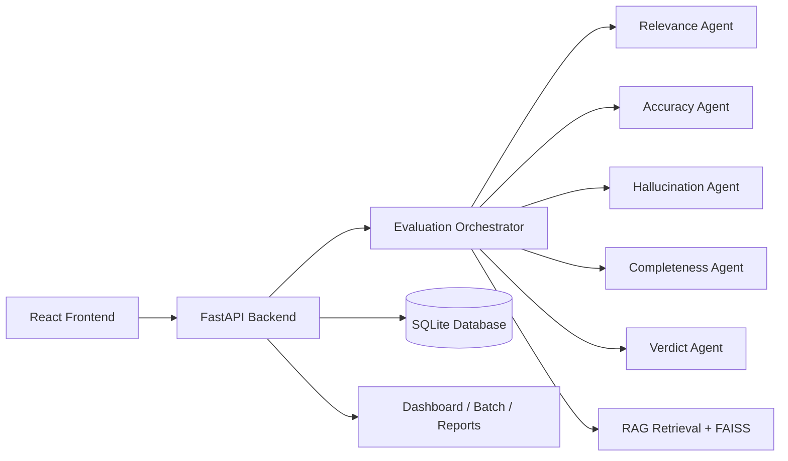

# AI Response Validation & Hallucination Detection System

## 1. Project Title
AI Response Validation & Hallucination Detection System

## 2. Problem Statement
Large language models often generate fluent but unsupported or incorrect answers. Enterprises need a verifiable evaluation workflow that checks factual accuracy, relevance, completeness, and hallucination risk using grounded evidence and stored records.

## 3. Objectives
- Evaluate AI responses with multi-agent reasoning.
- Use RAG retrieval to ground answers in trusted evidence.
- Detect unsupported, contradicted, and incomplete claims.
- Produce weighted verdicts and dashboard analytics from stored database records.
- Support batch evaluation and PDF export for operational reporting.

## 4. Features
- Single-response evaluation
- Batch CSV validation and processing
- Agent-based relevance, accuracy, hallucination, and completeness scoring
- Verdict generation with weighted thresholds
- FAISS-backed retrieval and knowledge ingestion
- Dashboard overview and recent evaluation history
- PDF report export from real evaluation data
- SQLAlchemy store for structured results and batch summaries

## 5. System Architecture



## 6. Technology Stack
- Backend: Python, FastAPI, SQLAlchemy, SQLite
- Frontend: React, TypeScript, Vite, Tailwind CSS
- Retrieval: FAISS, semantic embeddings, chunking
- PDF export: ReportLab
- Testing: Pytest

## 7. RAG Architecture
The system stores chunked reference documents, embeds them, and retrieves top-k relevant evidence for each evaluation. This evidence is compared against the AI response to support factual verification and hallucination flagging.

## 8. Evaluation Pipeline
1. Receive question + AI response + optional reference answer.
2. Retrieve relevant chunks from the knowledge base.
3. Run relevance, accuracy, hallucination, and completeness agents.
4. Generate weighted overall score and verdict.
5. Persist structured results and evidence in the database.

## 9. Agent Responsibilities
- Relevance Agent: checks answer alignment with the prompt.
- Accuracy Agent: measures factual correctness against reference truth and retrieved evidence.
- Hallucination Agent: detects unsupported or contradicted claims.
- Completeness Agent: checks whether major aspects are covered.
- Verdict Agent: combines weighted metrics and critical overrides.

## 10. Scoring Dimensions
- Relevance: 0-5 judge scale, normalized once to 0-100 for aggregation
- Accuracy: 0-5 judge scale, normalized once to 0-100 for aggregation
- Hallucination Safety: 0-5 judge scale (5 = safe), normalized once to 0-100 for aggregation
- Completeness: 0-5 judge scale, normalized once to 0-100 for aggregation
- Overall weighted score: 0-100

Hallucination Percentage is distinct from Hallucination Safety: it is the percentage of analyzed response sentences explicitly contradicted by available evidence. Claims that are merely unsupported or cannot be verified are not counted as confirmed hallucinations; the denominator includes all analyzed response sentences, not only flagged contradictions.

## 11. Weighted Scoring Formula
The authoritative weighted score uses:

- Relevance = 25%
- Accuracy = 35%
- Hallucination Safety = 25%
- Completeness = 15%

This is normalized to produce the final 0-100 overall score.

## 12. Verdict Thresholds
- PASS: score >= 75
- NEEDS_IMPROVEMENT: 50-74
- FAIL: score < 50 or critical hallucination override

## 13. Database Schema
Core tables include:
- `evaluation_submissions`
- `evaluation_results`
- `agent_evaluations`
- `evaluation_history`
- `batch_evaluations`
- `batch_records`
- `knowledge_documents`
- `knowledge_chunks`
- `dataset_sources`
- `system_settings`

## 14. API Endpoints
- `POST /api/evaluations`
- `GET /api/evaluations`
- `GET /api/evaluations/{id}`
- `POST /api/batch/upload`
- `POST /api/batch/{batch_id}/evaluate`
- `GET /api/batch/{batch_id}`
- `GET /api/batch/{batch_id}/analytics`
- `GET /api/batch/{batch_id}/export`
- `GET /api/batch/{batch_id}/export-pdf`
- `GET /api/analytics/overview`
- `GET /api/system/status`
- `GET /api/knowledge-base/stats`

## 15. Input/Output Data Models
The backend uses Pydantic models for:
- `SingleEvaluationRequest`
- `EvaluationDetailResponse`
- `BatchUploadResponse`
- `BatchStatusResponse`
- `KnowledgeSearchRequest`
- `DashboardOverviewResponse`

## 16. CSV Format
Required fields:
```csv
question,ai_response,reference_answer,source_information
"What causes seasons?","The tilt of Earth causes seasonal differences in sunlight.","Earth's axial tilt changes sunlight distribution across the year.","Earth Science"
```

## 17. Single Evaluation Workflow
1. User enters a question and AI response.
2. Backend retrieves evidence.
3. Agents score the response.
4. Verdict is generated.
5. Result is stored in the database.
6. Details are displayed in the UI.

## 18. Batch Evaluation Workflow
1. Upload CSV.
2. Validate rows and reject malformed records.
3. Run evaluation for valid rows only.
4. Aggregate batch metrics.
5. Store results.
6. Display dashboard summary and export PDF/CSV.

## 19. Dashboard Metrics
- Total responses evaluated
- Verdict summary and percentages
- Average dimension scores
- Score distribution charts
- Hallucination statistics
- Completeness statistics
- Batch trends
- Common issues

## 20. PDF Report Structure
Generated PDFs include:
- report title
- metadata and batch summary
- average scores
- hallucination and completeness analysis
- row-by-row evaluation results
- evidence and agent reasoning
- recommendations and verdict indicators

## 21. Testing Methodology
The project uses pytest for end-to-end and validation checks. Tests cover:
- correct, incorrect, incomplete, and irrelevant responses
- hallucination detection and evidence support
- batch processing and export integrity
- backend import and evaluation flow

## 22. Test Results
This project is validated with pytest and the current suite passes successfully in the workspace.

## 23. Limitations
- The retrieval layer is local and benchmark-oriented, not a live enterprise search index.
- PDF export is generated from stored DB records rather than a live external data source.
- LLM evaluation still depends on the configured local or external model provider.

## 24. Future Scope
- Add multi-model comparison dashboards for ChatGPT/Gemini/
- Expand CSV schema validation and anomaly detection
- Add user authentication and role-based access
- Improve export templates and branded enterprise layouts

## 25. Installation Instructions
```bash
python -m pip install -r requirements.txt
```

## 26. Environment Variables
Example values:
```env
LLM_PROVIDER=local
HALLUCINATION_SENSITIVITY=standard
OPENAI_API_KEY=
GEMINI_API_KEY=
```

Set `SEED_DEMO_EVALUATIONS=true` only when manually scored demonstration evaluations are desired. Demo evaluations are disabled by default so fixed sample scores cannot be mistaken for results from the live evaluation pipeline.

## 27. How to Run Frontend
```bash
cd frontend
npm install
npm run dev
```

## 28. How to Run Backend
```bash
cd backend
python -m uvicorn app.main:app --reload --host 0.0.0.0 --port 8000
```

## 29. Quick Verification
```bash
cd "c:\Users\SHAIK RESHMA\OneDrive\Desktop\AI Project"
python -m pytest -q
```
